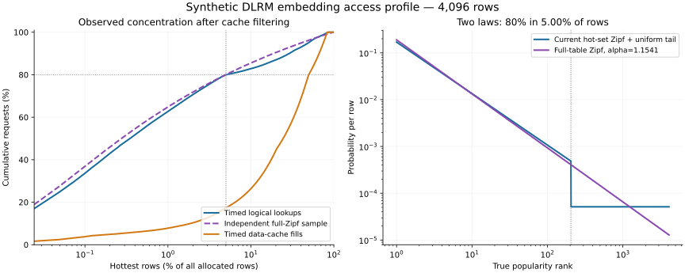

# Synthetic embedding access skew

The existing timed generator already reproduces the proposed **80% of lookups / 5%
of rows** split. An address-only profile of its default measured window finds
**79.9642% of logical embedding reads in the hottest 205 of 4,096 allocated rows**.
The generator selects a 205-row hot set (5.0049% after integer rounding), shuffles
those rows throughout the table, samples 80% of reads from that set using a Zipf
law with alpha 1.1, and samples the remaining 20% uniformly from the other rows.
This is a two-component distribution, rather than one Zipf law across all rows.

## Full-table Zipf model

For N rows, assign popularity rank r a probability

```text
p(r) = r^(-alpha) / sum(j^(-alpha), j=1..N)
```

Choose K = round(0.05 * N) and solve

```text
sum(p(r), r=1..K) = 0.80
```

The profiler solves this monotonic equation by bisection. For N=4,096, K=205,
**alpha = 1.154067593**. A different table size generally needs a different alpha
to preserve this concentration. An independent run of one million iid draws
produces **80.0622%** of requests in the known, fixed top-205 set. Its binomial
Wilson 95% interval is **79.9838%–80.1404%**. This checks the sampler against its
specified distribution; it does not validate a production workload.

Physical rows in this standalone sample are randomly permuted through the
contiguous table. The Python permutation is separate from C++'s permutation.
The full-table Zipf sample is an analysis artifact and is not fed into the timed
C++ simulator. Existing baseline timings and program addresses remain unchanged.



## Observed distributions

| Population | Requests | Observed hottest-205 share |
|---|---:|---:|
| Timed generator, complete-run logical embedding reads | 49,152 | 79.8889% |
| Timed generator, measured logical embedding reads | 36,864 | 79.9642% |
| Timed generator, measured embedding-read data fills | 6,826 | 17.3747% |
| Standalone full-Zipf iid sample, empirical hottest rows | 1,000,000 | 80.0680% |

These populations include accelerator reads only, selected by numeric table
addresses. Host accesses, stores and scratch are excluded. Data-cache hits count
as logical lookups; data fills select the subset that missed locally and may
retrieve data from memory or a peer. Each row of the table independently ranks
physical rows by its own observed counts, so the hottest fill rows need not be
the hottest logical-read rows.

Unaccessed allocated rows are included in the denominator. Selecting the hottest
rows using the same observations creates upward selection bias; these empirical
shares are descriptive. The standalone sampler additionally reports the share
in its **known fixed** top-K set, to which the Wilson interval applies. The tool
exports rank-CDF differences as descriptive distances, not KS tests or p-values.
There is no assumed Zipf reference for the cache-filtered fill population.

The fill profile demonstrates why an 80/5 logical-access split alone cannot
predict coherence benefits: the cache transforms the distribution seen by the
shared-memory system. Writes, node sharing, phase lengths and queueing still need
to be measured by the baseline profiler.

## Reproduce

Use a DLRM run with `--events 1`, such as the default experiment output:

```bash
python3 scripts/profile_embedding_skew.py \
    --metrics results/blind/default.dlrm.metrics.csv \
    --events results/blind/default.dlrm.events.csv \
    --output-prefix results/blind/skew --samples 1000000 --seed 42
python3 -m unittest discover -s tests -p test_embedding_skew.py -v
```

The analyzer uses only Python's standard library. It writes `.summary.json` and
`.ranks.csv`; the latter contains one row per allocated row for each population,
with observed count, address, rank, cumulative share and the applicable expected
logical law. It ignores `AccessKind` labels. Sampling and layout seeds are separate
from the timed simulator's request generation. Parent output directories must exist.

Optional figure generation requires matplotlib:

```bash
python3 scripts/plot_embedding_skew.py results/blind/skew
```

It writes `.png` and `.svg`. The six unit tests cover finite-Zipf calibration,
uniform and impossible targets, denominator/rounding correctness, address/node/
read filtering, reproducible sampling and absent Zipf assumptions for data fills.

## What makes it representative

Power-law behavior is a reasonable synthetic starting point: production embedding
access frequencies vary both within and across tables. The exact 80/5 split is a
configurable hypothesis, not a universal constant. [RecShard, ASPLOS 2022](https://trippel-lab.stanford.edu/pubs/asplos2022_RecShard.pdf)

For greater fidelity, fit a distribution per table to measured row frequencies,
then compare reuse-distance/interarrival distributions, batch duplicates,
correlation across accelerators, hot-set drift and the location/cadence of host
writes. Static iid Zipf samples reproduce popularity, but they do not establish
those temporal or concurrency properties. Row width, pooling factors and table
sizes also determine the resulting memory traffic.

Meta provides a public synthetic embedding-lookup dataset designed to resemble
production reuse patterns. Its indices/offsets and documented reuse histograms
provide a stronger calibration target than an assumed 80/5 rule. This profiler
has not yet replayed that dataset. [Meta embedding lookup dataset](https://github.com/facebookresearch/dlrm_datasets)
